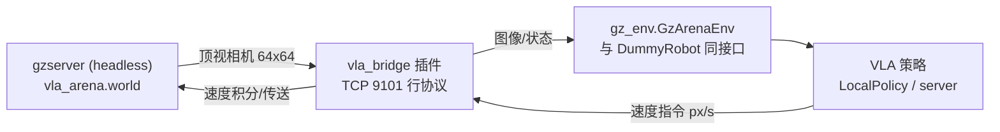

# test/ —— Gazebo 仿真部署与验证（Gazebo Harmonic / gz-sim 8）

把 `mini_vla` 的合成任务**原样搬进 Gazebo**：顶视虚拟相机（64×64，视场恰好 64cm×64cm，
**1 像素 = 1 厘米**）、蓝/绿方块、红/黄十字、速度控制的智能体、可推动的箱子——
训练分布与仿真世界逐像素对齐，VLA 策略在仿真中闭环运行。



## 文件

| 文件 | 说明 |
| --- | --- |
| `gazebo/vla_bridge.cpp` | gz-sim8 系统插件：TCP 行协议（STATE/VEL/SET_POSE/GET_IMAGE） |
| `gazebo/vla_arena.world` | 竞技场世界：地面/智能体/箱子/双十字/顶视相机/侧视监控相机 |
| `gazebo/build.sh` | 插件编译（`pkg-config gz-sim8`） |
| `run_gazebo.sh` | 启动 headless 仿真（xvfb-run + 软件渲染） |
| `gz_env.py` | Python 环境客户端：`get_obs/step/reset` 与 mini_vla 完全同接口 |
| `calibrate.py` | 相机像素↔世界映射自检（自动写 calib.json） |
| `collect_gazebo_data.py` | 脚本专家采集**仿真域内**演示数据 |
| `gz_dataset.py` / `train_gz.py` | 域内数据集（实拍帧）与训练 |
| `demo1_camera_inference.py` | demo1：虚拟相机 + 推理联通验证 |
| `demo2_closed_loop.py` | demo2：reach 任务闭环 rollout（成功率 + Wilson CI） |
| `demo3_push_safety.py` | demo3：push 闭环 + 看门狗受控停止 + 安全层裁剪 |

## VM 上的完整流程

```bash
# 0) 依赖（Ubuntu 24.04, Gazebo Harmonic 已装）
sudo apt-get install -y build-essential pkg-config libgz-sim8-dev
pip3 install --break-system-packages torch --index-url https://download.pytorch.org/whl/cpu pillow

# 1) 编译插件
bash test/gazebo/build.sh            # -> BUILD_OK, 生成 libvla_bridge.so

# 2) 启动仿真（后台）
nohup bash test/run_gazebo.sh > test/gzserver.log 2>&1 &

# 3) 相机标定（自动校验 1px=1cm 映射与图像朝向）
cd test && python3 calibrate.py      # -> CALIB-OK

# 4) 采集仿真域内数据 + 训练（数据飞轮）
python3 collect_gazebo_data.py --n 60 --out gz_data.npz
python3 train_gz.py --data gz_data.npz --out runs/gz_model --epochs 15

# 5) 三个 demo 验证
python3 demo1_camera_inference.py --ckpt runs/gz_model/ckpt.pt
python3 demo2_closed_loop.py      --ckpt runs/gz_model/ckpt.pt --episodes 10
python3 demo3_push_safety.py      --ckpt runs/gz_model/ckpt.pt
```

## 与真实部署的对应关系

| 仿真里的东西 | 真实对应 |
| --- | --- |
| 顶视虚拟相机 64×64 | RealSense/工业相机 + 固定安装 |
| vla_bridge TCP | 相机 SDK + 控制器 SDK（或 ROS 2） |
| `SET_POSE`/`RESET` | 机器人回 home 位 / 复位工装 |
| 插件内速度积分 + 碰撞推箱 | 低层控制器速度模式 + 物理接触 |
| 接触代理（距离阈值） | 力/触觉传感器 |
| 背景自动增益（gz_env） | 光照域差校正（docs/12 §16） |

## 排障

- `ERR no_image` / IMG_STATUS 帧数不涨：传感器系统未渲染——确认 xvfb 与 `LIBGL_ALWAYS_SOFTWARE=1`，日志查 ogre2 初始化；用 `gz topic -l | grep image` 核对 topic 名。
- 传送后箱子漂移：等物理沉降（`reset` 已内置静止检测）。
- 成功率低：先跑 `calibrate.py` 确认映射误差 <2.5px，再确认训练用的是域内数据（gz_data 而非合成数据）。
