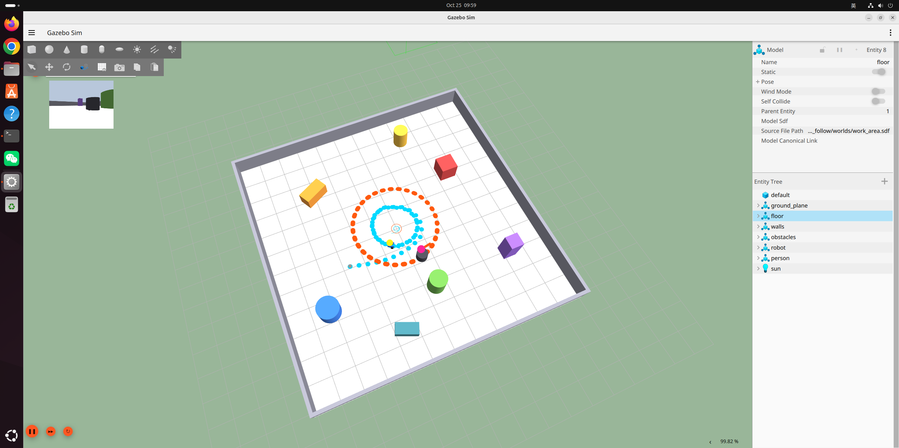

# Gazebo 里显示机器人与目标的位置和轨迹

## 一、怎么启动

在虚拟机桌面的终端里（**必须在图形会话里跑**，SSH 直连要先 `export DISPLAY=:0`）：

```bash
cd /home/earl/workspace/VLA
./vla_demo/show_follow.sh          # 默认跟随距离 1.0m
./vla_demo/show_follow.sh 1.5      # 指定跟随距离
```

脚本做的事：起 Gazebo → 起 `traj_viz.py` 轨迹可视化 → 发 FOLLOW 指令。
Gazebo 窗口保持打开，轨迹实时刷新；Ctrl-C 收尾。



## 二、窗口里的图例

| 元素 | 含义 |
|---|---|
| 橙色小点串成的圆环 | **目标的行走轨迹**（每 0.4m 一颗） |
| 青色小点在环内 | **机器人的行驶轨迹** |
| 品红色球 | 目标当前位置 |
| 黄色球 | 机器人当前位置 |
| 贴着身子的小方块（橙/青） | 各自当前朝向 |
| 灰色小球 | 起点 |
| 四片半透明扇形（绿/蓝/黄/紫） | **4 台深度相机的实时视野**，跟随机器人位姿一起转 |

四片扇形拼成一个完整的圆盘，相邻交界处颜色叠加变深——那一段就是两台相机
的重叠区。默认按 100° 视场画，半径为 3m。

轨迹是**持久**的，不随相机移动而消失，可以跑完再回头看整条路径。
右侧 Entity Tree 里能看到 `robot` / `person`，可以点开看实时位姿。

### 视野扇形的开关

```bash
python3 vla_demo/traj_viz.py --fov 100 --fov-r 3.0   # 默认
python3 vla_demo/traj_viz.py --fov-r 5.0             # 画得更远
python3 vla_demo/traj_viz.py --no-fov                # 关掉扇形
```

`--fov` 要和 `work_area.sdf` 里的 `horizontal_fov` 保持一致
（当前 1.7453293 rad = 100.000°）。

## 三、这次跑出来的结果

一圈圆周目标（半径 2m、线速度 0.32 m/s），机器人从 1.6m 外追上去，跑 111 s：

| 指标 | 数值 |
|---|---|
| 跟随距离 均值 / 标准差 | **1.19 m / 0.084 m**（设定 1.0 m） |
| 落在 1.00±0.15 m 内的时间占比 | 30.3%（均值有 +0.19m 的估计偏置） |
| 目标落在对正带（\|方位\|≤15°）占比 | **99.1%**，平均 \|方位\| **5.0°** |
| 距离跟踪态（而非原地对正）占比 | **97.6%** |
| 角速度符号翻转 | 0.21 次/秒（早期版本 0.56 次/秒） |
| 安全层急停 / 卡死脱困 | **0 次 / 0 次**（没有误触发） |

稳态距离有个 +0.19m 的**恒定**偏置（标准差只有 0.084m，说明不是抖动），
来自视觉测距的估计偏置，不是控制问题；跟得稳、不来回晃才是重点。
机器人轨迹是一个半径略小的同心圆——滞后导致"抄内道"，这是跟随超调的典型形态。

## 四、实现要点（换环境时容易踩的坑）

轨迹不是改 world 加插件做的，而是用 **Gazebo GUI 自带的 MarkerManager**：

1. **它是服务式接口，不是话题式**
   `/marker`（单条 Marker）、`/marker_array`（批量 Marker_V）、`/marker/list`（查询）。
   网上常见的"往 `/marker` 话题 publish"在 Harmonic 上不起作用。
2. **必须在 `~/.gz/sim/8/gui.config` 的 MarkerManager 节点里写 `<topic_name>/marker</topic_name>`**
   否则服务名是空的，插件根本不 advertise，日志里只有一句很含糊的
   `Unable to create marker of type[...]`，排查起来很费时间。
   本项目已经写好，`/marker/list` 不通时 `traj_viz.py` 会直接报错退出。
3. **LINE_STRIP 的线宽不生效**（ogre 后端恒为 1px），所以轨迹靠"面包屑小球"铺出来，
   线只作为辅助。ARROW（type 12）这套 GUI 不支持，会用 BOX 短棒代替。
4. **采集与渲染必须分离**：把 service 请求放在位姿回调里，服务端一慢就会把采集
   一起拖成 2 秒一帧，看起来像"机器人根本没动"。
5. **SSH 启动仿真要先 `export DISPLAY=:0`**，否则 gz 的 Qt 初始化失败直接退出，
   但各 ROS 节点还在跑、日志看着正常，位姿和图像却全是空的。

## 五、相关文件

| 文件 | 作用 |
|---|---|
| `vla_demo/traj_viz.py` | 轨迹采集与 marker 推送节点（纯 gz-transport，不依赖 ROS） |
| `vla_demo/show_follow.sh` | 一键演示脚本 |
| `traj_log.csv` | 轨迹原始数据 `t,rx,ry,ryaw,px,py,pyaw`，可直接画 2D 图核对 |
