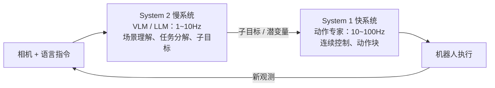

# 01 - 基本原理

> [!abstract] 一句话定义
> **VLA（Vision-Language-Action）**：以「相机图像 + 本体感知」为视觉输入、以「自然语言指令」为任务输入，**端到端直接输出机器人动作**的多模态策略模型。形式化：
> $$a_{t:t+H} \sim \pi_\theta(\,\cdot \mid \underbrace{I_t^1,\dots,I_t^K,\; s_t}_{\text{观测 }o_t},\; \ell\,)$$
> 其中 $I_t^k$ 为第 $k$ 路相机图像，$s_t$ 为本体感知（关节角/末端位姿/夹爪开度等），$\ell$ 为语言指令，$a_{t:t+H}$ 为未来 $H$ 步的**动作块（action chunk）**。

---

## 1 为什么需要 VLA：与传统模块化方案的对比

传统机器人系统是「感知 → 规划 → 控制」的模块化流水线，每个模块人工设计与调参：

| 维度 | 传统模块化方案 | VLA 端到端方案 |
| --- | --- | --- |
| 泛化到新物体/指令 | 差（需要重新建模、标定） | 好（继承 VLM 的互联网级语义先验） |
| 开放词汇理解 | 无（只能识别预定义类别） | 有（"把那个能装咖啡的杯子拿过来"） |
| 误差传播 | 级联放大（检测误差 → 规划失败） | 端到端优化，无显式级联 |
| 可解释性 / 可验证性 | 高（每步可检查） | 低（黑盒，需靠评估体系兜底） |
| 确定性 / 实时性 | 可保证硬实时 | 概率性，推理有抖动 |
| 数据需求 | 少（靠模型与标定） | 大（靠演示数据覆盖场景分布） |
| 安全认证 | 成熟方法 | 尚在建立中（需外挂安全层，见 [[10-评估与安全]]） |

> [!important] 核心洞察（RT-2 的贡献）
> 在互联网图文数据上预训练的视觉-语言表征，对机器人控制有**迁移价值**：VLA 能执行训练数据中从未出现过的语义组合（如"把恐龙玩具挪到斐波那契数列卡片上"），这是传统 pipeline 做不到的"语义涌现"。

---

## 2 三要素拆解

### 2.1 V —— 视觉编码
- 输入：全局相机（场景级）+ 腕部相机（操作级），通常 1–4 路；分辨率 224–512 常见。
- 编码器：ViT（PaliGemma、SigLIP、DINOv2 等），或 VLM 自带的视觉塔。
- 本体感知（proprioception）：关节角、末端位姿、夹爪状态，通常经 MLP 投影成若干 token，与视觉 token 拼接。

### 2.2 L —— 语言理解
- 指令经 LLM/VLM 的文本 tokenizer 编码；VLA 的语言侧能力几乎完全来自 VLM 预训练。
- 指令模板在训练与部署必须**逐字符一致**（高频坑，见 [[09-易错知识点]]）。
- 指令可分层：任务级（"收拾餐桌"）→ 子目标级（"把杯子放进水槽"）→ 动作级，对应双系统架构（§5）。

### 2.3 A —— 动作生成（VLA 的本质差异点）

**动作空间常见选择：**

| 动作空间 | 维度示例 | 适用 |
| --- | --- | --- |
| 关节位置/速度增量 | 7DoF 臂 + 1 夹爪 = 8 | 通用、平滑 |
| 末端（EEF）位姿增量 ΔT | dx,dy,dz + 轴角旋转 3 + 夹爪 = 7 | 直观、跨机型统一（OXE 惯例） |
| 移动底盘 + 机械臂 | 底盘 2–3 + 臂 6–7 | 移动操作（见 [[12-附录A-特殊场景处理]]） |
| 灵巧手 | 20+ | 高自由度，数据昂贵 |

**动作表示三大流派：**

| 流派 | 代表 | 原理 | 优点 | 缺点 |
| --- | --- | --- | --- | --- |
| ① 离散 token | RT-1/RT-2、OpenVLA | 每维均匀切 256 桶，动作变成"词表"，LLM 自回归输出 | 与语言模型统一；可复用 LLM 解码栈 | 自回归逐 token 慢；量化损失；难以表达多峰分布 |
| ② 连续回归头 | ACT、OpenVLA-OFT | 在 VLM 表征上接 MLP/Transformer 头，直接回归动作块（L1/Huber 损失） | 并行解码快（OFT 提速 25–50 倍）；平滑 | 单点回归难以拟合多模态演示分布 |
| ③ 生成式头（Diffusion / Flow Matching） | π0、GR00T、RDT | 从噪声出发，学习向量场把噪声"流"到动作分布；训练学速度 $v_\theta(x_t,t)$，推理十步左右 ODE 积分 | 可表达多峰分布；输出平滑；频率高（π0 达 50Hz） | 训练/推理复杂度高；采样步数与随机性需一致 |

> [!tip] FAST 动作 tokenizer（π0 系）
> 用 DCT 压缩 + 熵编码把连续动作序列变成高频"子词"，兼得 token 化的架构统一性与比 256-bucket 高得多的分辨率。openpi 中与 flow head 并列提供。

---

## 3 动作块（Action Chunking）与执行模式

模型一次预测未来 $H$ 步动作（$H$ 典型 8–100），而非单步。这是 VLA 平稳性的关键：

- **为什么**：隐藏推理延迟与网络抖动；让优化目标偏向"整段轨迹"而非"单步最优"；显著降低策略抖动。
- 三种执行模式：
  1. **全开环**：执行完整 chunk 再取新观测（延迟不敏感、简单，但长 chunk 漂移大）；
  2. **滚动时域 Receding Horizon**：每步（或每 k 步）重新推理，只执行第 1 步（最常用，鲁棒）；
  3. **时间集成 Temporal Ensemble（ACT）**：同一时刻被多个 chunk 覆盖，按指数权重融合（更平滑，代价是并行推理多）。

## 4 训练范式

- **主范式是模仿学习（行为克隆）**：最小化 $\mathbb{E}\,\mathcal{L}(\hat a_{t:t+H}, a^*_{t:t+H})$，演示数据来自遥操作/仿真。
- **共训练（co-training）**：机器人数据与互联网图文/视频数据混训，防止 VLM 灾难性遗忘（π0.5 的"知识隔离"进一步把通用知识梯度隔离在 VLM 内）。
- **可选 RL 微调**：对成功率瓶颈任务用在线/离线 RL（DAgger、RLPD 类）继续提升，工程上少用但有价值。
- 预训练 → 微调的迁移结构见 [[05-训练流程]]。

## 5 双系统架构（System 1 / System 2）

受认知科学"快/慢思维"启发，2025 年后的主流形态（GR00T N1、Helix、π0.5 均为此思路的变体）：

- **System 2**：重语义、低频，负责"做什么"；可以是完整 VLM 甚至带思维链（2026 年趋势：Embodied CoT，见 [[02-发展历程与主流模型]]）。
- **System 1**：重反应、高频，负责"怎么动"；参数量小（Helix 的 S2 仅 80M 量级），常用 flow/diffusion 头。

## 6 概念边界：VLA ≠ VLM ≠ World Model

| 概念 | 回答的问题 | 输出 |
| --- | --- | --- |
| VLM | "这张图里是什么、什么关系" | 文本 |
| VLA | "接下来该做什么动作" | 动作序列 |
| World Model | "如果我这样做，世界会变成什么样" | 下一状态预测 $p(s_{t+1}\mid s_t,a)$ |

> [!note] 2026 年趋势
> World Model 与 VLA 正在融合（如 NVIDIA GR00T N2 的"世界动作模型"路线）：用世界模型做想象与数据生成，用 VLA 做动作输出；VLA 内部也越来越多地引入显式推理（思维链）作为中间表示。完整谱系见 [[02-发展历程与主流模型]]。

## 7 最小心智模型（背下来）

1. VLA = **VLM 骨干 + 动作头**，语言与视觉理解来自预训练，动作能力来自机器人数据微调。
2. 数据决定上限：模型结构只是把数据分布"压缩"进来（见 [[04-数据体系]]）。
3. 动作表示与 chunking 决定实时性与平滑性（见 [[03-架构与技术选型]]）。
4. 训练用模仿学习 + 共训练防遗忘；评估必须真机 rollout，loss 不等于成功率（见 [[05-训练流程]]、[[09-易错知识点]]）。
5. 部署必须外挂**独立于模型**的安全层（见 [[06-部署与推理]]、[[10-评估与安全]]）。

---
**下一步**：[[02-发展历程与主流模型]] ｜ 动手：[[08-完整实现代码]]
