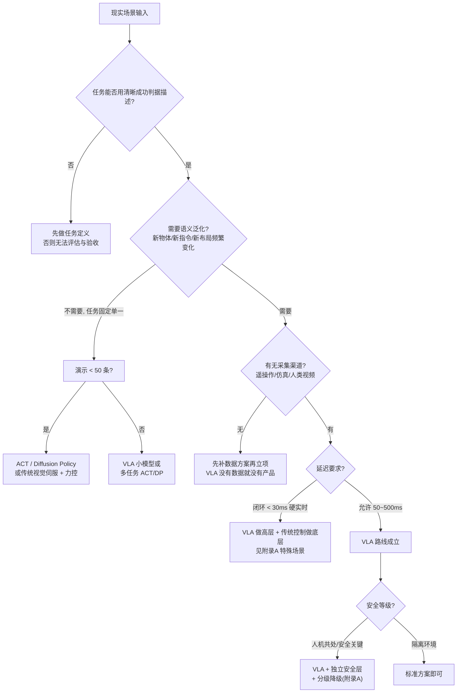
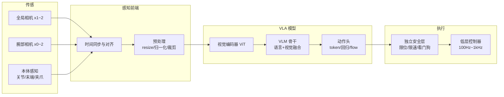

# 03 - 架构与技术选型

> [!abstract] 本章解决
> 拿到一个真实场景后，如何搭系统、如何做每一个技术决策。所有决策结论必须回填到 [[11-模板-VLA项目实施手册]] 的「选型决策卡」。

## 1 第一问：这个场景适不适合 VLA？

> [!important] 诚实的技术判断
> 工业落地里相当比例的成功项目用的是 **ACT / Diffusion Policy / 传统视觉伺服**而非 7B VLA。VLA 的价值在于**语义泛化与任务灵活性**；如果任务高度固定、节拍严格，小模型更便宜可靠。把这条写进立项评审。

## 2 通用系统架构

典型张量流（以 7B VLA、2 相机为例）：图像 `(2,3,224,224)` → ViT patch tokens `(2,256,1152)` → 与语言 token 拼接 → VLM 骨干 → 取最后层表征 → 动作头 → 动作块 `(H=8~50, 7)`。

## 3 关键决策表

### 3.1 模型路线

| 决策点 | 选项 A | 选项 B | 选择依据 |
| --- | --- | --- | --- |
| 基座 | SmolVLA 450M | OpenVLA/π0 系 3~7B | 算力、语言泛化要求；<8GB 显存 → SmolVLA |
| 微调方式 | LoRA (r=16~64) | 全参数 | 数据 < 1k 条用 LoRA；> 10k 且预算足可全参 |
| 动作头 | 沿用基座默认 | 换 flow/回归头 | 默认即可；自定义动作空间才改 |
| 预训练数据 | 只用任务数据 | + OXE/DROID 共训 | 需要跨任务泛化才共训 |
| 双系统 | 单模型 | 高层 VLM + 低层 VLA | 长时程多阶段任务选后者 |

### 3.2 传感配置

| 配置 | 成本 | 能力 | 备注 |
| --- | --- | --- | --- |
| 单全局相机 | 低 | 桌面级抓放 | 必须能同时看到物体与目标 |
| 全局 + 腕部 | 中 | 精细操作、遮挡鲁棒 | **强烈推荐**；腕部相机是性价比最高的升级 |
| + 深度相机 | 高 | 3D 精确定位 | 反光/透明物体失效（附录 A） |
| + 力/触觉 | 高 | 插孔、柔性体 | 以 token/特征注入模型 |

### 3.3 算力规划（经验值，以 2026 年主流开源栈为参考）

| 阶段 | SmolVLA 450M | OpenVLA 7B + LoRA | π0 3.3B 微调 |
| --- | --- | --- | --- |
| 训练 | 1× RTX 4090（数小时~1 天） | 1~4× A100/4090（1~3 天） | 4~8× A100（1~3 天） |
| 推理 | 消费 GPU / Jetson Orin 可行 | ~16–18GB 显存（OFT 优化后） | 20GB+ 显存 |
| 控制 | chunk 执行下 5–30Hz 闭环 | chunk + 异步推理可达 10–30Hz | 50Hz chunk |

> [!tip] 异步推理是延迟问题的答案
> 执行器消费当前 chunk 的同时，GPU 在后台为下一 chunk 推理（SmolVLA 验证吞吐翻倍）。架构上就是把「推理进程」与「控制进程」解耦，见 [[06-部署与推理]] 与 `code/mini_vla/server.py`。

## 4 软件栈推荐

| 层 | 推荐组件 |
| --- | --- |
| 数据 | LeRobot 数据集格式（parquet + mp4）；遥操作 GELLO / leader-follower / VR |
| 训练 | PyTorch + HuggingFace transformers/peft；SmolVLA 用 lerobot-train；π0 用 openpi(JAX) |
| 推理服务 | FastAPI + uvicorn（教学）/ vLLM、torch.compile、int8（生产） |
| 控制 | ROS 2 / 自研 EtherCAT 栈；控制器频率与策略频率解耦 |
| 仿真评估 | Isaac Lab / MuJoCo / ManiSkill |
| 运维 | 模型-配置-镜像三位一体版本管理；遥测上报（见 06） |

## 5 选型输出物（进入模板）

完成本章决策后，把结论填入 [[11-模板-VLA项目实施手册]] **P2 选型决策卡**，至少包含：基座模型与版本号、微调方式、动作空间与维度、相机配置、控制频率、chunk 长度、训练硬件、推理硬件、安全层规格。

---
**下一步**：[[04-数据体系]] ｜ 流程图：[[07-业务流程图]]
