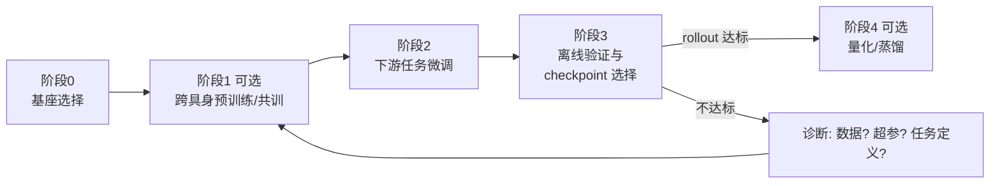

# 05 - 训练流程

> [!abstract] 本章解决
> 从基座到可用 checkpoint 的完整训练流程：范式、损失、超参、监控与防遗忘。配套代码见 [[08-完整实现代码]]（`mini_vla/train.py` 与 `openvla_finetune/finetune_openvla_lora.py`）。

## 1 总体流程



## 2 阶段 0：基座选择

| 需求 | 推荐 |
| --- | --- |
| 消费级 GPU、快速验证 | SmolVLA（LeRobot 栈，`lerobot-train` CLI 微调） |
| 语言泛化、单/双臂操作 | OpenVLA-OFT（LoRA） |
| 高频灵巧操作 | π0 / π0.5（openpi，JAX） |
| 人形/跨本体 | GR00T N1.5 |
| 从 VLM 自建（仅大团队） | VLM 骨干（PaliGemma/Qwen-VL 系）+ 自选动作头，参考 [[01-基本原理]] §2.3 |

## 3 阶段 1（可选）：预训练 / 共训练

- 目的：让动作头与 VLM 对齐、获得跨任务动作先验；数据：OXE/DROID + 自有全量数据。
- **共训练防遗忘**：机器人数据与图文数据按比例混合（经验 1:1 ~ 1:4 图文:机器人，需消融），防止 VLM 语义能力被机器人数据冲掉。
- π0.5 的**知识隔离**：动作 token 的梯度不回传破坏 VLM 通用层，通用知识与动作能力分层训练——自研双系统时值得借鉴。

## 4 阶段 2：下游微调

### 4.1 LoRA 配置（7B 级 VLA 经验起点）

| 项 | 推荐值 | 说明 |
| --- | --- | --- |
| rank | 16（简单任务）~ 64（复杂/多任务） | 太低会学不动动作分布 |
| target_modules | 注意力 q/k/v/o + MLP | 只挂注意力常欠拟合 |
| 学习率 | 5e-4（LoRA）/ 2e-5（全参） | LoRA 可比全参大一个量级 |
| batch | 有效 batch 32–256（梯度累积凑） | 动作头损失对 batch 不敏感 |
| 轮数 | 收敛为准，小数据 20–60 epoch | 靠 val loss + rollout 选点 |
| 精度 | bf16 混合精度 | fp16 易溢出 |

### 4.2 损失函数（按动作头）

| 动作头 | 损失 | 备注 |
| --- | --- | --- |
| 离散 token | 交叉熵（对动作 token 位置） | 忽略语言 token 的 loss |
| 连续回归 | L1 / Huber | 对抖动演示更稳 |
| Diffusion (DDPM) | $\|\epsilon - \epsilon_\theta(x_t,t)\|^2$ | 训练/推理采样步数必须一致 |
| Flow matching | $\|v - v_\theta(x_t,t)\|^2$，$v$ 为条件向量场 | π0 系；推理 10 步左右 ODE |

### 4.3 训练配置模板（YAML）

```yaml
# vla_finetune.yaml —— 填入模板 P3 训练配置卡
base_model: "openvla/openvla-oft-7b"      # 基座与精确版本号
data: "lerobot_dataset/my_task_v3"         # 数据集版本号
action_space:
  type: "delta_eef"                        # delta_eef | delta_joint | joint_pos ...
  dims: 7                                  # 含义顺序写入元数据!
  chunk_len: 16
norm_stats: "norm_stats_v3.json"           # 见 04 §4，随模型部署
lora: { rank: 32, alpha: 64, dropout: 0.0, targets: ["q_proj","k_proj","v_proj","o_proj","mlp"] }
optim: { lr: 5.0e-4, warmup_steps: 100, schedule: cosine, weight_decay: 0.0, grad_clip: 1.0 }
train: { epochs: 40, batch_size: 16, grad_accum: 8, precision: bf16, ema: 0.999 }
co_train: { enabled: false, text_data: null, mix_ratio: 0.2 }
eval: { val_every_epoch: 2, save_top_k: 3, rollout_env: "sim:my_task" }
seed: 42
```

## 5 阶段 3：离线验证与 checkpoint 选择

> [!danger] Loss 下降 ≠ 机器人变强
> 离线 val loss 与真机成功率**相关性有限**（过拟合演示风格也会降 loss）。checkpoint 选择必须依赖 **rollout 评估**：仿真环境自动评估 + 真机抽样评估（协议见 [[10-评估与安全]]）。至少对 top-3 checkpoint 分别做 rollout 再定版。

- 保存策略：每 N epoch 存一次 + 保留 EMA 权重；记录每个 checkpoint 的归一化统计与提示模板版本。
- 快速诊断表：

| 症状 | 优先排查 |
| --- | --- |
| val loss 高且不降 | 数据量/质量、动作头容量、学习率过小 |
| val loss 低但 rollout 差 | 归一化不一致、图像预处理不一致、观测-动作时序错位、过拟合演示风格 |
| rollout 时 robot 抖动 | chunk 执行模式、动作未平滑、数据含抖动演示 |
| 换指令就失效 | 指令模板 train/eval 不一致、语言标注多样性不足 |

## 6 阶段 4（可选）：部署前优化

- 量化 int8/int4（配合 OFT 并行解码或 vLLM）；torch.compile；小模型蒸馏（7B → 450M 需重新评估成功率损失）。
- **每次优化后必须重跑评估矩阵**，不能直接替换线上模型。

## 7 训练监控

- 记录：train/val loss、动作头各维误差、梯度范数、学习率、（flow 头）采样步数、硬件利用率。
- 每次实验写一行实验卡（模型版本 + 数据版本 + 配置 diff + 结果链接），用表格管理，避免"哪个模型是哪次跑的"说不清。
- 随机性控制：固定 seed；diffusion/flow 头在评估时固定采样器与步数。

## 8 训练完成检查清单

- [ ] checkpoint + 归一化统计 + 提示模板 + 配置文件 四位一体归档
- [ ] 至少 3 个候选 checkpoint 完成 rollout 评估并有记录
- [ ] 评估矩阵通过门禁（[[10-评估与安全]]）
- [ ] 实验卡与数据卡齐全
- [ ] 复现脚本一键可跑（固定 seed 与数据版本）

---
**下一步**：[[06-部署与推理]]
