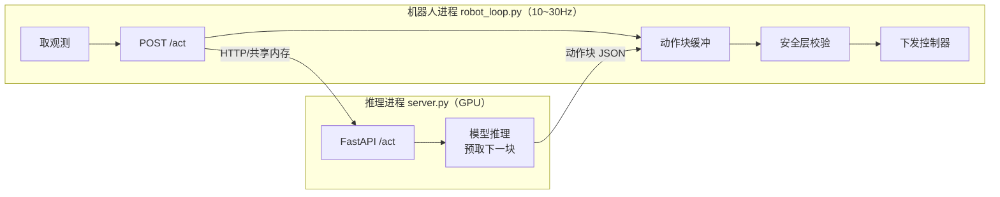

# 06 - 部署与推理

> [!abstract] 本章解决
> 从"实验室 checkpoint"到"现场稳定运行"：架构、延迟、执行模式、安全层、监控与灰度。参考实现：`code/mini_vla/server.py` + `code/mini_vla/robot_loop.py`。

## 1 部署架构选型

| 架构 | 延迟 | 适用 | 风险 |
| --- | --- | --- | --- |
| 边缘 GPU（机器人本体/柜内，Jetson Orin / 4090 工控机） | 最低、稳定 | 首选生产架构 | 算力上限、散热 |
| 车间工作站（一拖 N） | 中，内网 | 多台设备共享算力 | 一台宕机影响多机 |
| 云推理 | 高且抖动 | 仅离线/非实时任务 | 网络故障=全线停摆 |

> [!important] 默认原则
> 实时控制回路**永远不经过公网**。云只做训练、监控、模型分发。

## 2 推理延迟预算（示例：7B VLA + OFT，单 4090）

| 环节 | 预算 | 备注 |
| --- | --- | --- |
| 图像采集 + 传输 | 5–30 ms | USB3 带宽与驱动是常见瓶颈 |
| 预处理 | 2–5 ms | resize/归一化，避免多余拷贝 |
| 模型推理 | 30–200 ms | chunk 一次出 H 步，摊薄到每步很低 |
| 安全层校验 | <1 ms | 必须轻量 |
| 下发执行 | 1–5 ms | EtherCAT/CAN |
| **闭环节奏** | **10–30 Hz（chunk 推进）** | 控制器内部仍 100Hz–1kHz |

延迟不达标的三板斧：① 量化/编译加速；② 异步推理（§3）；③ 换小模型/换双系统分工。

## 3 异步推理与 chunk 执行模式

- **异步推理**：控制进程消费当前动作块的同时，推理进程在后台预计算下一块（SmolVLA 验证吞吐翻倍、响应快 30%）。实现上是一个「双缓冲 + 队列」的生产者-消费者结构。
- **执行模式**（见 [[01-基本原理]] §3）：

```python
# 滚动时域（receding horizon，默认推荐）：每步重推理太贵时每 k 步推理一次
# 时序集成（temporal ensemble，ACT 风格）：多块重叠区按指数权重融合
w = {i: exp(-lam * i) for i in range(H)}   # 越新的块权重越大
a_t = sum(w[i] * chunk_i[t - t0_i] for i in overlapping) / sum(w[i] for i in overlapping)
```

选择：任务需要反应性（避障、插孔）→ receding horizon；追求平滑（擦拭、喷涂）→ temporal ensemble。

## 4 进程与接口结构（参考实现对应关系）



生产环境把 HTTP 换成共享内存/gRPC 即可；**接口契约（观测字段、动作语义、归一化统计版本）必须写进协议文档**。

## 5 安全层（独立于模型，永不信任模型输出）

按顺序逐条校验，任何一条不过 → 丢弃动作并触发降级：

1. **看门狗**：推理超时（如 500ms 无新动作块）→ 保持/减速停止
2. **工作空间限制**：笛卡尔软限位盒 + 关节限位，越界裁剪
3. **速度/加速度上限**：按安全区域（人机共处区上限更低，参考 ISO/TS 15066 的功率与力限）
4. **观测合理性**：图像黑帧/丢帧、本体感知 NaN → 暂停
5. **急停链路**：硬件急停独立于软件，软件急停 <10ms 响应
6. **不确定性降级**：多采样动作分歧过大（flow/diffusion 可测）→ 减速或请求接管

## 6 监控与数据飞轮

| 指标 | 说明 |
| --- | --- |
| 成功率 / 干预次数 | 班次级统计，趋势比对 |
| 推理延迟 P50/P99 | 抖动比均值更重要 |
| 安全层拦截次数与原因分布 | 频繁拦截 = 模型或场景漂移信号 |
| 硬件遥测 | GPU 温度（热节流导致周期性卡顿）、相机丢帧率 |

**数据飞轮**：现场所有运行片段（含失败）自动落盘 → 每周人工/半自动标注失败模式 → 回流训练集 → 迭代版本。这是 VLA 产品持续变强的唯一途径，写入 [[11-模板-VLA项目实施手册]] P6。

## 7 版本管理与灰度

- **三位一体版本**：模型权重 + 归一化统计 + 提示模板（外加预处理参数）必须同版本发布，任何单点更新都算新版本。
- 灰度流程：新模型先在**影子模式**（只推理不执行，与线上模型输出比对）跑 ≥1 周 → 1 台设备试运行 → 分批推广；保留 5 分钟内可回滚的上一版本。

---
**下一步**：[[07-业务流程图]]
