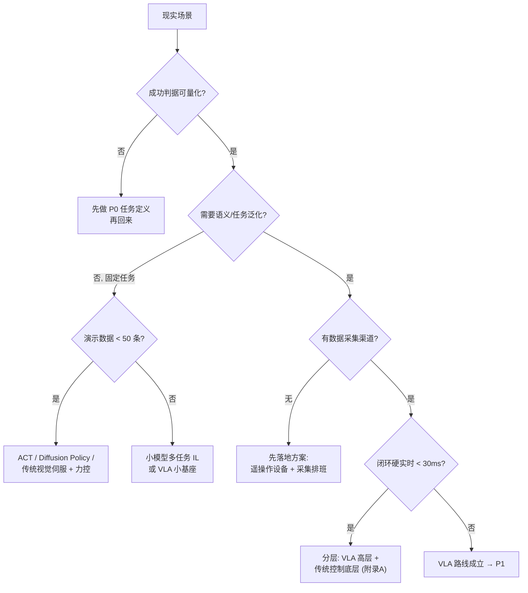
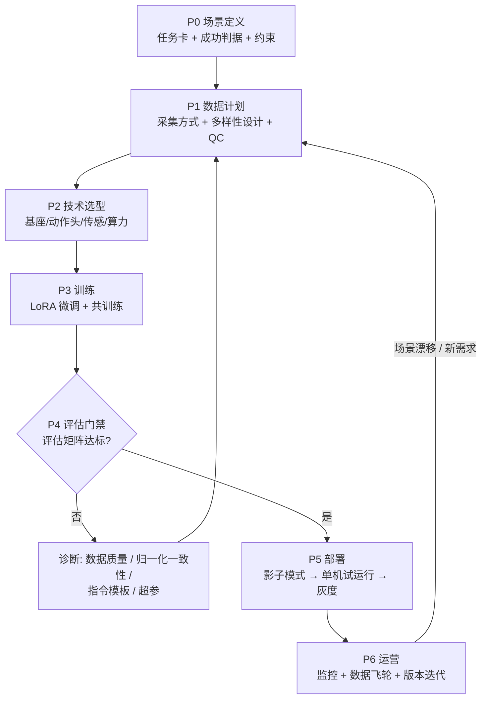
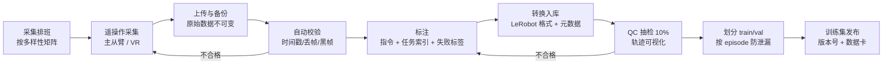
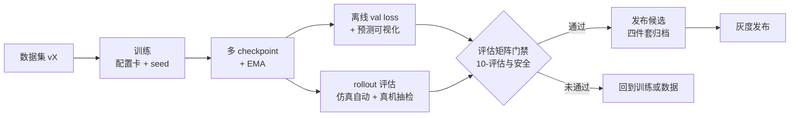
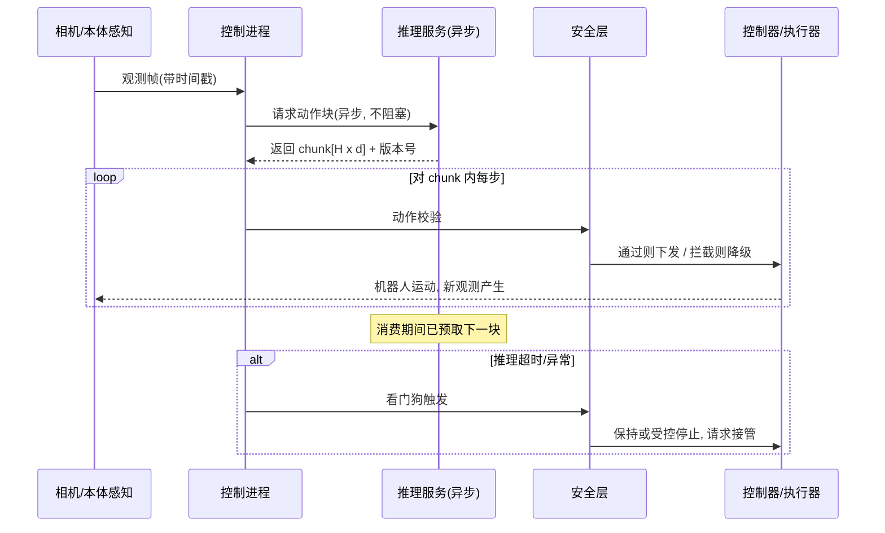
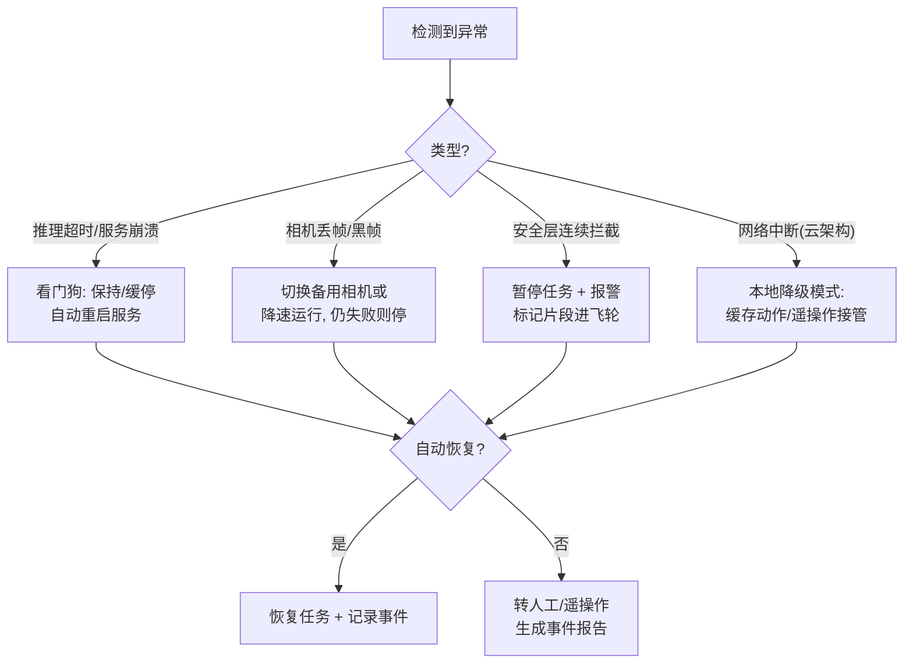
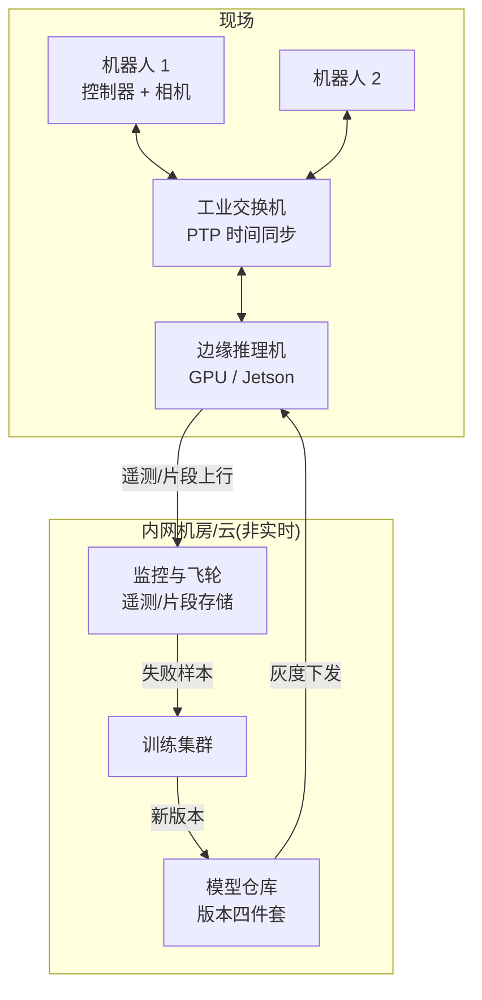

# 07 - 业务流程图

> [!abstract] 本章是全套业务的"地图层"
> 7 张 Mermaid 图覆盖：立项决策、端到端总流程、数据流水线、训练-评估流水线、在线推理时序、故障降级、部署拓扑。落地时复制进 [[11-模板-VLA项目实施手册]] 对应阶段。

## 图 1 · 立项决策树（先问要不要 VLA）

## 图 2 · 端到端业务总流程

## 图 3 · 数据生产流水线

## 图 4 · 训练-评估流水线（含门禁）

## 图 5 · 在线推理时序（单步闭环）

## 图 6 · 故障与降级决策

## 图 7 · 部署拓扑（生产参考）

---
**使用提示**：每张图右键可导出；放进项目文档时保留"图号"，评审时按图索骥。配套阶段动作见 [[11-模板-VLA项目实施手册]]。
