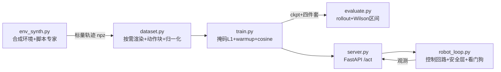

# 08 - 完整实现代码

> [!abstract] 本章解决
> 两套互补代码的结构、运行方法与移植要点。**代码文件就在本库 `code/` 目录下**，本章负责"为什么这样写"以及"怎么换成你的机器人"。

## 1 两条代码路径

| 路径 | 目的 | 依赖 | 硬件 |
| --- | --- | --- | --- |
| `code/mini_vla/` | 教学全流程：合成任务上跑通 数据→训练→评估→服务→控制 全闭环 | torch + numpy（服务模式加 fastapi 等） | CPU 可跑 |
| `code/openvla_finetune/` | 工程路径：真实生产使用的开源 VLA 微调与部署骨架 | transformers + peft（建议官方仓库环境） | 24GB+ GPU |

## 2 mini_vla：数据流与文件职责



关键设计（每条都是生产原则的缩影）：

1. **只存标量轨迹，图像按需确定性渲染**——数据文件几 MB、完全可复现（真实项目对应"原始数据不可变 + 确定性预处理"）。
2. **观测-动作因果对齐**：`state[t]` 是执行动作前的观测，`actions[t]` 是从它出发的动作。这是 [[09-易错知识点]] 的头号坑，本仓库从数据生成起就按正确约定实现。
3. **归一化四件套**：checkpoint + norm_stats.json + vocab.json + 提示模板，同版本归档（`train.py` 自动完成）。
4. **动作块 + 掩码 L1**：未来 H 步一起回归，episode 末端 padding 不计损失；成功后的零动作保留在监督里，策略才学得会"停下"。
5. **推理/控制解耦**：`server.py` 出动作块，`robot_loop.py` 以 10Hz 消费、只执行块内第 1 步（滚动时域），看门狗连续 3 次失败 → 受控停止。
6. **安全层独立于模型**：NaN 检查 → 限速 → 软限位，任何一条不过就丢弃动作（`SafetyLayer.check`）。

## 3 运行步骤（mini_vla）

```bash
cd code/mini_vla
python env_synth.py data_synth.npz 200            # 400 条合成演示（reach+push 各 200）
python train.py --data data_synth.npz --out runs/mini_vla
python evaluate.py --ckpt runs/mini_vla/ckpt.pt   # 报告每任务成功率+Wilson95%CI
python server.py --ckpt runs/mini_vla/ckpt.pt     # 终端 A
python robot_loop.py --mode server --api http://127.0.0.1:8000 --task push   # 终端 B
```

预期量级：40 epoch 后 reach ≈ 85–100%、push ≈ 60–95%（合成任务教学参考值）。评估不达标时按 [[05-训练流程]] §5 诊断表排查——这个"训练→评估→诊断"循环本身就是模板 P3→P4 的微缩版。

## 4 移植到真实机器人：接口对照表

模板思想的演示：**换机器人 = 换环境/硬件接口，算法代码不动。**

| 合成实现 | 真实对应 | 必须保持的契约 |
| --- | --- | --- |
| `env_synth.render_frame` | 相机 SDK 取帧 | 分辨率/预处理与训练一致 |
| `DummyRobot.get_obs().state` | 关节编码器/末端位姿读数 | 维度顺序、单位、归一化写进元数据 |
| `env_synth.env_step` | 控制器 SDK 下发速度/位置 | 动作语义（增量/绝对）、坐标系、频率 |
| `is_success` | 视觉/传感器成功判据 | 与验收标准一致 |
| `MiniVLADataset` 状态归一化 | 服务端状态预处理 | 同一份 norm_stats |
| `SafetyLayer` | 安全 PLC + 软件安全层 | 独立于模型，永不信任模型输出 |

移植步骤：① 用真实数据替换 `env_synth.gen_dataset`（格式转 LeRobot）；② 把动作维度 `action_dim=2` 改为你的动作空间并在 `MiniVLAConfig` 调整；③ `robot_loop.DummyRobot` 换成硬件实现；④ 其余照旧。

## 5 openvla_finetune：工程路径骨架

- `finetune_openvla_lora.py`：OpenVLA 7B + LoRA。展示四个生产关键点：分位数归一化与统计量归档、动作 token 化（256 桶 + 词表偏移规则）、labels 只监督动作 token、**部署四件套落盘**（adapter + processor + norm_stats + 提示模板）。真实项目建议直接用官方仓库（离散 token 用 openvla，连续动作块用 openvla-oft，后者推理快 25–50×）。
- `deploy_openvla.py`：官方 `model.predict_action(unnorm_key=...)` 真机回路，5Hz 起步，标注了相机/机器人 SDK 的替换点和"gripper 语义反转"等现场事故高发区。

## 6 从教学模型走向生产模型的改造清单

| 改造项 | 教学版 | 生产方向 |
| --- | --- | --- |
| 骨干 | 从零训练 Transformer | OpenVLA / π0 / SmolVLA 基座 + LoRA |
| 动作头 | tanh 回归 | flow matching（π0）或并行解码连续头（OFT） |
| 语言 | 30 个词的模板词表 | LLM tokenizer + 指令模板 + 多样性标注 |
| 数据 | 合成 400 条 | 真机遥操作 100–1000 条/任务（[[04-数据体系]]） |
| 评估 | 合成 rollout | 仿真自动评估 + 真机评估矩阵（[[10-评估与安全]]） |
| 部署 | FastAPI 单进程 | 异步双缓冲 + 量化 + 监控（[[06-部署与推理]]） |

## 7 Gazebo 仿真部署（code/test/）

`code/test/` 提供完整的 Gazebo Harmonic (gz-sim 8) 部署与验证栈：虚拟顶视相机（64×64，视场恰好 64cm×64cm，**1px=1cm**）、速度控制智能体、可推箱子、双十字目标，与合成任务分布逐像素对齐。

- **C++ 系统插件** `test/gazebo/vla_bridge.cpp`：把世界封装成 TCP 行协议（STATE/VEL/SET_POSE/GET_IMAGE），编译 `bash test/gazebo/build.sh`（`pkg-config gz-sim8`）。
- **Python 侧** `test/gz_env.py`：`GzArenaEnv` 与 `DummyRobot` **同接口**（get_obs/step/reset）——换仿真不换算法代码。
- **标定** `test/calibrate.py`：自动校验像素↔世界映射与图像朝向（本项目实测误差 0.67px）。
- **域差校正**：`gz_env.image()` 背景灰度自动增益到训练分布中位（[[12-附录A-特殊场景处理]] §16 的最小实现）。
- **数据飞轮实练**：`collect_gazebo_data.py`（脚本专家采集仿真域内数据）→ `train_gz.py`（域内训练）。
- **3 个 demo**：① 虚拟相机+推理联通验证；② reach 闭环 rollout（成功率+Wilson CI）；③ push 闭环+看门狗受控停止+安全层裁剪。详见 `test/README.md`。

---
**下一步**：[[09-易错知识点]]（先读再训，能省一周）
