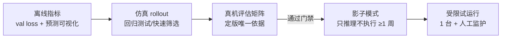
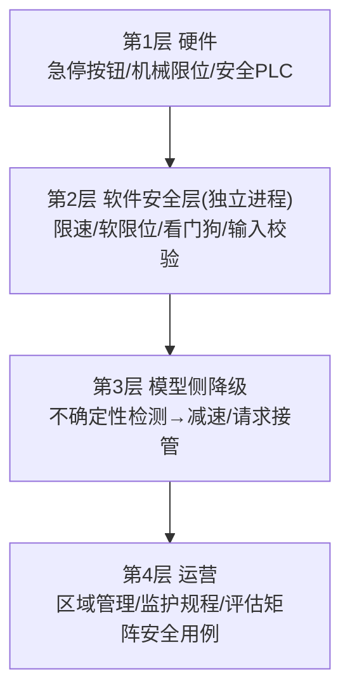

# 10 - 评估与安全

> [!abstract] 本章解决
> 怎么算"可用"：指标、评估矩阵、置信度；以及安全体系的设计与验收门禁。评估矩阵和安全清单是 [[11-模板-VLA项目实施手册]] P4/P5 的直接输入。

## 1 指标体系

| 指标 | 定义 | 用途 |
| --- | --- | --- |
| 成功率 SR | 成功次数 / 总次数 | 主指标 |
| 部分进度 | 子目标完成数、物体移动距离比例 | 诊断"差多少" |
| 干预率 | 人工接管次数 / 小时 | 生产可用性 |
| MTBF | 平均无故障间隔 | 运营指标 |
| 首次成功时间 | 任务开始→成功的时长 | 效率 |
| 延迟 P50/P99 | 端到端回路耗时 | 实时性验证 |
| 安全事件数 | 拦截/急停/碰撞 | 一票否决项 |

成功率必须带**置信区间**（小样本下 80% 与 95% 无显著差异）：

$$\text{Wilson 95\% CI: } \frac{p + z^2/2n \pm z\sqrt{p(1-p)/n + z^2/4n^2}}{1 + z^2/n}$$

参考实现：`code/mini_vla/evaluate.py::wilson_ci`。经验：每条件 **n ≥ 20** 起步，验收建议 n ≥ 30。

## 2 评估矩阵（泛化轴 × 条件）

> [!important] 只测一个条件 ≠ 评估
> 把"泛化"拆成显式维度，每格 ≥20 次并报 CI。**这一整张表复制进模板 P4 评估矩阵卡。**

| 泛化轴 | 条件示例 | n | SR | 95% CI |
| --- | --- | --- | --- | --- |
| 物体位姿 | 训练分布内随机 / 网格化极限位姿 | 20×2 | | |
| 物体实例 | 训练见过 / 同类新实例 / 同类不同色 | 20×3 | | |
| 指令 | 训练原句 / 同义改写 / 从未见措辞 | 20×3 | | |
| 光照 | 正常 / 弱光 / 强逆光 | 20×3 | | |
| 背景/干扰物 | 原工位 / 换背景 / 加干扰物 | 20×3 | | |
| 干扰与鲁棒 | 人经过 / 轻微遮挡 / 相机轻碰 | 20×3 | | |
| 长时程 | 单任务 / 连续 10 任务串行 | 5×2 | | |
| 安全用例 | 推理断流 / 越界指令 / 急停响应 | 10×3 | — | 响应时间 |

失败分类随评估记录：`{抓空 | 掉落 | 碰撞 | 位置偏差 | 提前停止 | 死循环 | 指令误解 | 其他}`，统计分布进入诊断报告。

## 3 三级评估流程

- 仿真（Isaac Lab / MuJoCo / ManiSkill）：跑得快、可自动化，用于回归测试与超参筛选；**sim2real gap 主要来自视觉与动力学**，不能替代真机定版。
- 真机：固定初始位姿库 + 随机化规则，脚本化记录每次试验（视频+日志+结果），可追溯。

## 4 验收门禁（Gate，模板 P4 直接引用）

| 级别 | 通过标准（示例，按项目改） |
| --- | --- |
| 原型 Gate | 分布内 SR ≥ 80%（CI 下界 ≥ 70%），零碰撞 |
| 试点 Gate | 评估矩阵全格 SR ≥ 75%；干预率 ≤ 5 次/小时；安全用例全过 |
| 生产 Gate | 连续 2 周 MTBF ≥ 目标值；P99 延迟 < 预算；数据飞轮闭环运行 |

## 5 安全体系（分层防御）

设计原则：

1. **永不信任模型输出**：安全层独立进程，逐条校验（`code/mini_vla/robot_loop.py::SafetyLayer` 是最小示例）。
2. **失效安全（fail-safe）**：任何异常（超时/NaN/丢帧/拦截连发）→ 保持或受控停止，绝不"带病重试"。
3. **人机共处**：参考 ISO 10218（工业机器人安全）与 ISO/TS 15066（协作机器人，功率/压力限值）；速度与分离监控：人近 → 降速 → 停。
4. **不确定性降级**：flow/diffusion 头可多次采样，动作分歧大 → 判定低置信 → 减速或接管请求。
5. **变更管理**：模型/配置任何变更都重跑安全用例（评估矩阵末行）。

## 6 安全测试规程（最小集）

- [ ] 硬件急停响应 < 标称值，且在推理卡死时仍有效
- [ ] 软件看门狗：断开推理服务 → 受控停止 ≤ 阈值时间
- [ ] 软限位：下发越界动作 → 被裁剪/拒绝并记录
- [ ] 限速：安全区内速度上限生效
- [ ] 人在路径：进入减速区 → 降速；进入禁入区 → 停止
- [ ] 断电/断网恢复后的安全启动流程
- [ ] 最坏情况延迟下的控制连续性（chunk 执行完仍无新块）

---
**配套**：[[11-模板-VLA项目实施手册]]（P4 评估矩阵卡、P5 安全配置卡）
