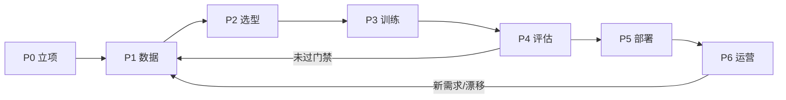
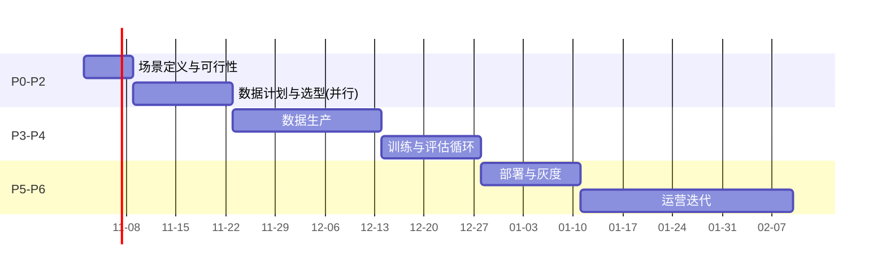

# 11 - 模板：VLA 项目实施手册 ⭐

> [!abstract] 使用方法
> **复制本文件为新项目文档 → 逐节填空 → 按 P0→P6 顺序推进**。每个阶段有：目标、输入、动作清单、输出物、完成定义（DoD）。遇到特殊场景查 [[12-附录A-特殊场景处理]]；每步操作细节回链对应章节。填不完 = 还没到那个阶段，不要跳。

---

## 0 项目章程（先填这张卡）

| 项 | 填写 |
| --- | --- |
| 项目名 | |
| 业务目标（一句话） | |
| 机器人本体（型号/自由度/负载） | |
| 任务场景（工位描述） | |
| 立项日期 / 目标上线日期 | |
| 负责人 / 数据 / 训练 / 部署各谁 | |
| 预算（硬件 + 人力 + 算力） | |
| 红线（绝不允许的行为，如碰撞、越界） | |

---

## P0 · 场景定义与可行性（1 周）

**目标**：把业务需求翻译成可评估的机器学习问题；判断是否该用 VLA。
**动作**：
- [ ] 填「任务定义卡」（下表）
- [ ] 跑 [[07-业务流程图]] 图 1 决策树，记录路线结论
- [ ] 现场踏勘：光照、空间、人流、电源、网络、安装位
- [ ] 识别特殊场景，逐条对照 [[12-附录A-特殊场景处理]]

**任务定义卡**

| 项 | 填写 | 备注 |
| --- | --- | --- |
| 任务描述（目标状态导向） | | 如"把料件 A 放入托盘 2 号槽" |
| 操作对象（种类/尺寸/重量/材质） | | 反光/柔性/透明在此标注 |
| 成功判据（唯一定义，可自动判定） | | 与评估/验收共用 |
| 节拍要求（单任务时长） | | |
| 闭环频率 / 可接受延迟 | | <30ms 硬实时 → 附录 A §3 |
| 精度要求 | | mm 级 → 附录 A §7 |
| 安全等级 / 人机关系 | | 人机共处 → 附录 A §4 |
| 环境变量（光照/振动/粉尘） | | → 附录 A §15 |
| 泛化需求（新物体/新指令/新布局的频率） | | 决定是否值得 VLA |
| 预期数据规模 | | 参照 [[04-数据体系]] §6 |

**DoD**：任务定义卡评审通过；路线结论（VLA / 小模型 IL / 混合 / 不做）有书面理由。

---

## P1 · 数据计划与生产（2–6 周）

**目标**：按计划产出合格训练数据。
**动作**：
- [ ] 选采集方式（[[04-数据体系]] §2 对比表）：主从臂 / VR / 手持 / 仿真
- [ ] 设计**多样性矩阵**（下表）——多样性比数量重要
- [ ] 采集排班与设备到位；先试采 10 条做 QC 校准
- [ ] 语言标注规范定稿（同义改写、目标态导向）
- [ ] 批量采集 → 自动校验 → 标注 → 转换（LeRobot）→ QC 抽检 10%
- [ ] 产出数据卡与 norm_stats（[[04-数据体系]] §4/§7）

**多样性矩阵（计划覆盖，采集后打勾）**

| 维度 | 计划覆盖值 |
| --- | --- |
| 物体初始位姿 | |
| 物体实例/颜色 | |
| 光照 | |
| 背景/干扰物 | |
| 指令措辞 | ≥3 种/任务 |
| 失败案例 | 标注保留 |

**DoD**：数量达标 + QC 清单全绿 + 数据卡成文；train/val 按 episode 划分无泄漏。

---

## P2 · 技术选型（3 天–1 周，与 P1 并行）

**目标**：定死技术栈，所有结论可追溯。
**动作**：
- [ ] 按 [[03-架构与技术选型]] §3 逐项决策并填下表
- [ ] 算力与预算核对（§3.3 表）
- [ ] 软件栈定版本（[[03-架构与技术选型]] §4）

**选型决策卡**

| 决策项 | 结论 | 理由 / 备选 |
| --- | --- | --- |
| 基座模型 + 精确版本 | | |
| 微调方式（LoRA r=? / 全参） | | |
| 动作空间（类型/维度/单位/坐标系/gripper 语义） | | 写进元数据！ |
| 动作头 / chunk 长度 H | | |
| 相机配置与安装位 | | |
| 本体感知维度与顺序 | | |
| 归一化方案 | | 分位数 q01/q99 默认 |
| 训练 / 推理硬件 | | |
| 控制频率 / 安全层规格 | | |

**DoD**：决策卡评审通过；动作/观测契约文档 v1 发布。

---

## P3 · 训练（1–5 天/轮）

**目标**：产出候选 checkpoint + 完整实验记录。
**动作**：
- [ ] 填训练配置卡（YAML，见 [[05-训练流程]] §4.3）
- [ ] 先 10% 数据试跑全流程（暴露管线 bug 的最快方式）
- [ ] 正式训练：多 checkpoint + EMA；实验卡逐轮记录
- [ ] 用 [[08-完整实现代码]] 的 `evaluate.py` 思路做仿真/离线 rollout 粗筛

**实验记录表（每行一次实验）**

| 日期 | 数据版本 | 配置 diff | val loss | rollout SR | 结论 |
| --- | --- | --- | --- | --- | --- |

**DoD**：≥3 个候选 checkpoint 通过粗筛；四件套归档（模型+统计+词表/模板+配置）。

---

## P4 · 评估与定版（3 天–1 周）

**目标**：用证据决定"能不能上线"。
**动作**：
- [ ] 复制 [[10-评估与安全]] §2 评估矩阵 → 逐格执行（每格 ≥20 次）
- [ ] 记录失败分类分布；top-3 checkpoint 对比
- [ ] 对照验收门禁（[[10-评估与安全]] §4）出评估报告

**评估矩阵卡**（直接粘贴 [[10-评估与安全]] §2 表格并填写）

**DoD**：达到项目对应的 Gate 级别；未达 → 回 P1（数据）或 P3（配置），禁止"带病上线"。

---

## P5 · 部署上线（1–2 周）

**目标**：稳定、安全、可回滚地上线。
**动作**：
- [ ] 定部署架构（边缘/工作站，[[06-部署与推理]] §1）与延迟预算（§2）
- [ ] 实现异步推理 + chunk 执行模式（§3）
- [ ] 实现独立安全层并过安全测试规程（[[10-评估与安全]] §6）
- [ ] 监控上线：成功率/干预率/延迟 P99/拦截分布/温度（§6）
- [ ] 灰度：影子 ≥1 周 → 单机监护 → 分批（图 2）；回滚预案演练一次

**部署配置卡**

| 项 | 填写 |
| --- | --- |
| 硬件 / 系统 / 驱动版本 | |
| 推理服务形式与超时阈值 | |
| chunk 执行模式 / 控制频率 | |
| 安全层规则（限速/限位/看门狗） | |
| 监控项与报警阈值 | |
| 回滚步骤（谁、多久） | |

**DoD**：灰度全通过；事故演练完成；四件套版本在线上与归档一致。

---

## P6 · 运营与迭代（持续）

**目标**：让系统随数据变强，而不是随时间变旧。
**动作**：
- [ ] 数据飞轮按周运转：失败片段 → 标注 → 训练集 → 新版本（[[06-部署与推理]] §6）
- [ ] 月度评估矩阵回归（防场景漂移）
- [ ] 模型迭代沿用 P3→P5 全流程与门禁，禁止跳过
- [ ] 变更管理：任何更新 = 新版本四件套 + 重跑安全用例

**运营周报模板**：成功率 / 干预率 / P99 延迟 / 拦截 Top3 原因 / 新增失败模式 / 本周数据回流 N 条。

---

## 里程碑参考（甘特）

## 风险登记表

| # | 风险 | 概率 | 影响 | 缓解 | 负责人 |
| --- | --- | --- | --- | --- | --- |
| 1 | 数据质量不达标返工 | 中 | 高 | 试采 QC 前置 | |
| 2 | 真机与仿真/离线表现差距大 | 高 | 高 | 评估矩阵前移、早接真机 | |
| 3 | 光照/场景漂移致性能退化 | 中 | 中 | 监控+月度回归+增广 | |
| 4 | 安全事件 | 低 | 极高 | 分层安全+演练 | |
| 5 | 关键人离职/设备到位延期 | 中 | 中 | 文档化(本库)+并行采购 | |

---
**交叉引用**：流程图 [[07-业务流程图]] ｜ 特殊场景 [[12-附录A-特殊场景处理]] ｜ 检查清单 [[13-附录B-术语表与检查清单]]
